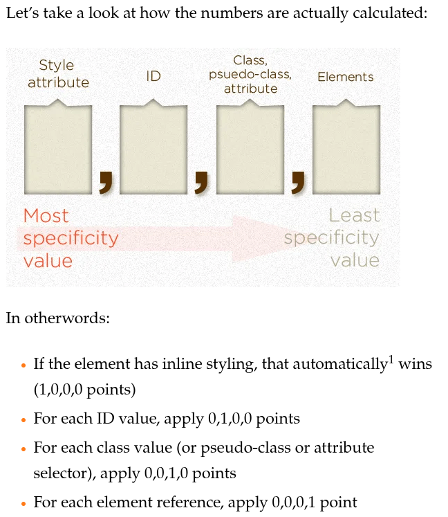
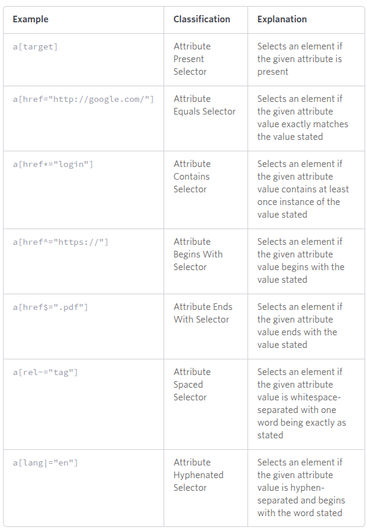

# Advance Selectors

## Child and Sibling combinators

- &gt; - the child combinator. Targets only the child of the element on its left side.
- &plus; - the next-sibling combinator. Targets only the next sibling element.
- ~ - the general sibling combinator. Targets all the sibling elements. The element on its left side is excluded

```html
<main class="parent">
  <div class="child group1">
    <div class="grand-child group1">This is grand-child 1</div>
  </div>
  <div class="child group2">
    <div class="grand-child group2">
      This is grand-child 2; I was targeted by .group1 + div
    </div>
  </div>
  <div class="child group3">
    <div class="grand-child group3">
      This is grand-child 3;I was targeted by .group1 + div + div
    </div>
  </div>
</main>
```

```css
main {
  padding: 10px;
  border: 3px solid black;
  display: flex;
  flex-direction: column;
  gap: 10px;
}

div .child {
  border: 1px solid red;
}

div .grand-child {
  border: 1px solid blue;
}

main > div > div {
  background-color: aqua;
}

.group1 + div {
  font-size: 1.5em; /*targets the next sibling of .group1, which is .group2*/
}

.group1 + div + div {
  font-size: 2em; /*targets the next next sibling of .group1, which is .group3*/
}

.group1 ~ div {
  color: brown; /*makes all the sibling element of .group1 text color to brown*/
}
```

Note: Just need to distinguish between the two

```css
div p{
  //property
}

div > p {
  //property
}
```

The second example tells us that the `div` and `p` elements have a parent-child relationship. The first one tells us that it may also be a parent child relationship. But what if we use their class in targeting the element. It would not apparently what relationship they have. So we need to use proper selectors.

```css
div .className {
  // this targets a div element that has a class of classname
}

div > .className {
  // this targets an element with a class of classname that is a child of div.
}

```

Here is another great resource [Complex Selectors](https://learn.shayhowe.com/advanced-html-css/complex-selectors/)

## CSS Specificity

Read more here: [CSS Specificity]


**Important Notes**

- The universal selector (\*) has no specificity value (0,0,0,0)
- Pseudo-elements (e.g. :first-line) get 0,0,0,1 unlike their psuedo-class brethren which get 0,0,1,0
- The pseudo-class :not() adds no specificity by itself, only what’s inside it’s parentheses.
- The !important value appended a CSS property value is an automatic win. It overrides even inline styles from the markup. The only way an !important value can be overridden is with another !important rule declared later in the CSS and with equal or great specificity value otherwise. You could think of it as adding 1,0,0,0,0 to the specificity value.

## Pseudo-selectors

### Pseudo-classes

- prefixed with a single colon and are a different way to target elements that already exist in the html.

#### Dynamic and user action pseudo-classes

- This type of pseudo classes are what makes the website more interactive and dynamic.
- example of pseudo-classes:
  - `:focus`
  - `:hover`
  - `:active`
  - `:link`
  - `:visited`
  - `:valid`
  - `:checked` - when checked, apply this css styles.
  - Check out other pseudo-classes here: [MDN Pseudo-classes]

#### Structural pseudo-classes

- Structural pseudo-classes are a powerful way to select elements based on their position within the DOM.
- example of structural pseudo-classes
  - `:root` this is where you place the global CSS rules like `box-sizing: border-box`
  - `:first-child` and `:last-child`
  - `:emtpy` matches elements that dont have child elements
  - `:only-child` matches elements that don't have siblings
  - `:nth-child` a dynamic approach for selecting an element

    ```css
    .myList:nth-child(5) {
      /* Selects the 5th element with class myList */
    }

    .myList:nth-child(3n) {
      /* Selects every 3rd element with class myList */
    }

    .myList:nth-child(3n + 3) {
      /* Selects every 3rd element with class myList, beginning with the 3rd */
    }

    .myList:nth-child(even) {
      /* Selects every even element with class myList */
    }
    ```

### Pseudo-elements

- Prefixed with a double colon and are use to target elements that
  _dont_ normally exist in the html.
- They allow us to affect parts of our HTML that aren’t elements at all.
- Sample pseudo-elements
  - `::marker` customize the styling of `<li>` elements bullets
  - `::first-letter` and `::first-line`
  - `::selection`
  - `::before` and `::after` allow us to add extra elements onto the page with CSS, instead of HTML.
  - more here [MDN Pseudo-elements]

## Attribute selectors

Since we write our own values for attributes, we need a slightly more flexible system to be able to target specific values.

Attribute selectors have the same specificity as classes and pseudo-classes (0, 0, 1, 0).

Let’s look at some examples for basic usage.

- `[attribute]` - This general selector will select anything where the given attribute exists. Its value doesn’t matter.
- `selector[attribute]` - Optionally we can combine our attribute selectors with other types of selectors, such as class or element selectors.
- `[attribute="value"]` - To get really specific, we can use = to match a specific attribute with a specific value.
  

  ```css
  [src] {
    /* This will target any element that has a src attribute. */
  }

  img[src] {
    /* This will only target img elements that have a src attribute. */
  }

  img[src="puppy.jpg"] {
    /* This will target img elements with a src attribute that is exactly "puppy.jpg" */
  }
  ```

  Sometimes we need to be more general in how we access these attributes. For example, perhaps we’re only interested in img elements where the src attribute’s value ends in .jpg. For cases like this we have some attribute selectors that allow us to match a part of the attribute’s value. If you’ve ever come across regular expressions before, these attributes use a similar syntax.

- [attribute^="value"] - ^= Will match strings from the start.
- [attribute$="value"] - $= Will match strings from the end.
- [attribute*="value"] - \*= The wildcard selector will match anywhere inside the string.

  ```css
  [class^="aus"] {
    /* Classes are attributes too!
      This will target any class that begins with 'aus':
      class='austria'
      class='australia'
    */
  }

  [src$=".jpg"] {
    /* This will target any src attribute that ends in '.jpg':
    src='puppy.jpg'
    src='kitten.jpg'
    */
  }

  [for*="ill"] {
    /* This will target any for attribute that has 'ill' anywhere inside it:
    for="bill"
    for="jill"
    for="silly"
    for="ill"
    */
  }
  ```

## Reference:

[CSS Specificity](https://css-tricks.com/specifics-on-css-specificity/#aa-calculating-css-specificity-value)  
[MDN Pseudo-classes](https://developer.mozilla.org/en-US/docs/Web/CSS/Reference/Selectors/Pseudo-classes)  
[MDN Pseudo-elements]: https://developer.mozilla.org/en-US/docs/Web/CSS/Reference/Selectors/Pseudo-elements
