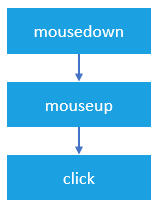
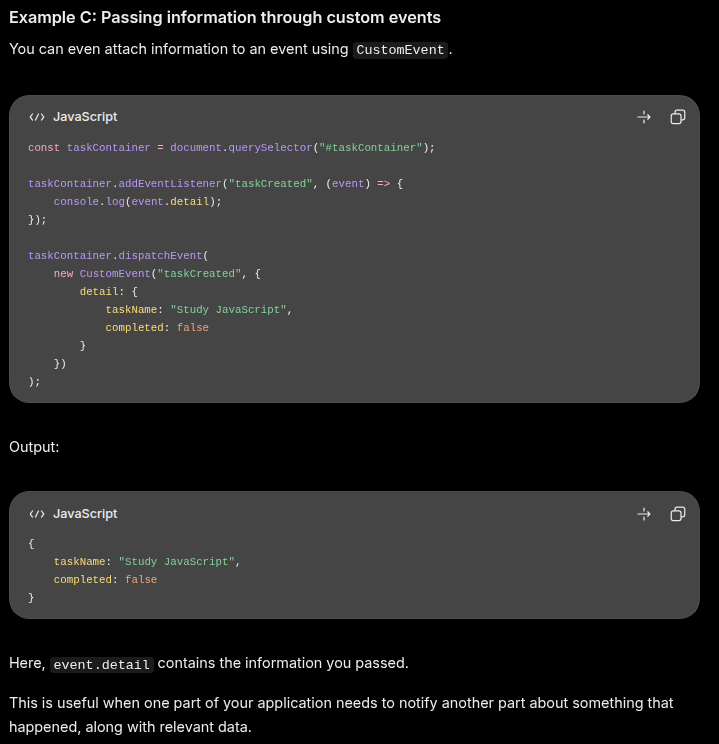

# DOM Manipulation

## Targeting nodes with selectors

```JavaScript
<div id="container">
  <div class="display"></div>
  <div class="controls"></div>
</div>
```

- When working with the DOM, you use “selectors” to target the nodes you want to work with. You can use a combination of CSS-style selectors and relationship properties to target the nodes you want. Let’s start with CSS-style selectors.
  - `div.display`
  - `.display`
  - `#container > .display`
  - `div#container > div.display`
- You can also use relational selectors (i.e., firstElementChild or lastElementChild, etc.) with special properties owned by the nodes.

  ```JavaScript
  // selects the #container div (don't worry about the syntax, we'll get there)
  const container = document.querySelector("#container");

  // selects the first child of #container => .display
  const display = container.firstElementChild;
  console.log(display);  // <div class="display"></div>
  ```

  ```JavaScript
  // selects the .controls div
  const controls = document.querySelector(".controls");

  // selects the prior sibling => .display
  const display = controls.previousElementSibling;
  console.log(display); // <div class="display"></div>
  ```

## DOM Methods

### Query Selectors

- Query selectors
  - `element.querySelector(selector)` - returns a reference to the first match of selector.
  - `element.querySelectorAll(selectors)` - returns a “NodeList” containing references to all of the matches of the selectors.

### Element creation

- `document.createElement(tagName, [options])` - creates a new element of tag type tagName. [options] in this case means you can add some optional parameters to the function. Don’t worry about these at this point.

### Append elements

### Remove elements

### Altering elements

### Adding inline style

### Editing Attributes

### Working with classes

### Adding text content

### Adding HTML content

### Events

#### [Mouse events](https://www.javascripttutorial.net/javascript-dom/javascript-mouse-events/#mousemove)

- `mouseover` vs `mouseenter`
  - `mouseover` bubbles and triggers for child elements. `mouseenter` does not bubble and triggers only when entering the element itself.
- `mouseout` vs `mouseleave`
  - `mouseout` bubbles and triggers if the pointer leaves the element or its child elements. `mouseleave` does not bubble and only triggers when leaving the element itself.
- `mousedown`, `mouseup`, and `click` events
  - When you click an element, there are no less than three mouse events fire in the following sequence:
    1. The `mousedown` fires when you press the mouse button on the element.
    2. The `mouseup` fires when you release the mouse button on the element.
    3. The `click` fires when one `mousedown` and one `mouseup` detected on the element.
       
- `mousemove`
  - The `mousemove` event fires repeatedly whenever you move the mouse cursor around an element. This `mousemove` event fires many times per second as the mouse is moved around, even if it is just by one pixel. This may lead to a performance issue if the event handler function is complex.

  - To avoid the performance issue, it is a good practice to add mousemove event handler only when you need it and remove it as soon as it is no longer needed, like this:
    ```JavaScript
    element.onmousemove = mouseMoveEventHandler;
    // ...
    //  later, no longer use
    element.onmousemove = null;
    ```

- Screen Screen / Client coordinates
  - _Screen_ refers to the monitor, _client_ refers to the web browser.

    ```HTML
    <!doctype html>
    <html lang="en">
      <head>
        <meta charset="UTF-8" />
        <meta name="viewport" content="width=device-width, initial-scale=1.0" />
        <title>DOM Manipulation</title>
        <script src="./script.js" defer></script>
        <link rel="stylesheet" href="style.css" />
      </head>
      <body>
        <h1>THE TITLE OF YOUR WEBPAGE</h1>
        <div id="container">
          <div class="content">This is the glorious text-content!</div>
        </div>
        <div id="area"></div>
        <div id="locationContainer">
          <p>Client X: <span class="clientX"></span></p>
          <p>Client Y: <span class="clientY"></span></p>
          <p>Screen X: <span class="screenX"></span></p>
          <p>Screen X: <span class="screenY"></span></p>
        </div>
      </body>
    </html>
    ```

    ```JavaScript
    const textContainers = document.querySelector("#locationContainer");
    const pad = document.querySelector("#area");
    pad.addEventListener("mousemove", (e) => {
      let clientY = textContainers.querySelector(".clientY");
      let clientX = textContainers.querySelector(".clientX");
      let screenX = textContainers.querySelector(".screenX");
      let screenY = textContainers.querySelector(".screenY");

      // the event(e) object has a method that gets the location of the mouse pointer
      clientX.innerText = e.clientX;
      clientY.innerText = e.clientY;
      screenX.innerText = e.screenX;
      screenY.innerText = e.screenY;
    });
    ```

#### [Keyboard Events](https://www.javascripttutorial.net/javascript-dom/javascript-keyboard-events/)

#### [`.dispatchEvent()`](https://www.javascripttutorial.net/javascript-dom/javascript-dispatchevent/)

- Functions:
  - Trigger an event without a user triggering it manually. This way you can reuse existing event listeners. Like you have a button that shows an alert when clicked.
    Using the `.dispatchEvent()` that alert will show without event clicking the button.
  - Passed somevalues using details
  - Communicating betweend different parts of your application.
    

#### [Custom Events](https://www.javascripttutorial.net/javascript-dom/javascript-custom-events/)

### NOTES:

- If you want to traverse the DOM downwards, use `querySelector()` methods and similar properties. This method is not limited to the `document`. it also applies to the element itself like the `body`. So you can do `body.querySelector(<target element>)` and it would work.
- If you want to traverse the DOM upwards, use `closest()` methods or something similar.

## Reference

[TOP](https://www.theodinproject.com/lessons/foundations-dom-manipulation-and-events)
