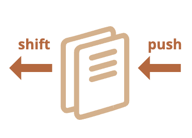
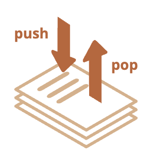
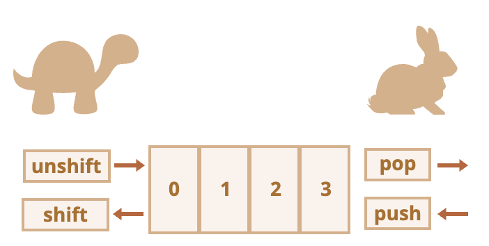
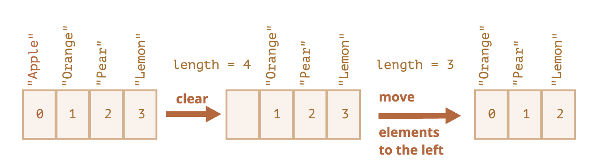

# Loops and Arrays

This section will contain notes about loops and arrays.

## Loops

- Occassionally in programming, we want to make things do something repeatedly until a certain condition is met. We do this by using a loop.

- Most of the time, we will loop through a _collection_ of items and would want to do something with each of the item inside that collection.

- One type of collection is an **Array**. But there are other collections in JavaScript like _Set_ or _Map_.

### Looping tools

#### The `for...of` loop

- This is mostly use through an array.

  ```JavaScript
  const cats = ["Leopard", "Serval", "Jaguar", "Tiger", "Caracal", "Lion"];

  for (const cat of cats) {
  console.log(cat);
  }
  ```

#### The `.map()`\_ and `.filter()`

- These two are methods of an array that is specialized for looping an array.
  - ._map()_ - below was passed a function inside the .map() as an argument. In this case, it returns the value to a new array.

    ```JavaScript
    function toUpper(string) {
      return string.toUpperCase();
    }

    const cats = ["Leopard", "Serval", "Jaguar", "Tiger", "Caracal", "Lion"];

    const upperCats = cats.map(toUpper);

    console.log(upperCats);
    // [ "LEOPARD", "SERVAL", "JAGUAR", "TIGER", "CARACAL", "LION" ]
    ```

  - _.filter()_ - you can use this filter to test each item of a collection and create a new collection that contains the item that match.

    ```JavaScript
    function lCat(cat) {
      return cat.startsWith("L");
    }

    const cats = ["Leopard", "Serval", "Jaguar", "Tiger", "Caracal", "Lion"];

    const filtered = cats.filter(lCat);

    console.log(filtered);
    // [ "Leopard", "Lion" ]

    ```

#### The standard `for` loop

- systax is : `for( initializer; condition; final-expression){ <code goes here... >}`.
- Here we have:
  1. The keyword for, followed by some parentheses.

  2. Inside the parentheses we have three items, separated by semicolons:
     - An initializer — this is usually a variable set to a number, which is incremented to count the number of times the loop has run. It is also sometimes referred to as a counter variable.
     - A condition — this defines when the loop should stop looping. This is generally an expression featuring a comparison operator, a test to see if the exit condition has been met.
     - A final-expression — this is always evaluated (or run) each time the loop has gone through a full iteration. It usually serves to increment (or in some cases decrement) the counter variable, to bring it closer to the point where the condition is no longer true.

  3. Some curly braces that contain a block of code — this code will be run each time the loop iterates.

- With the example from for..of, we can rewrite the code like this.

  ```JavaScript
  const cats = ["Leopard", "Serval", "Jaguar", "Tiger", "Caracal", "Lion"];

  for (let i = 0; i < cats.length; i++) {
  console.log(cats[i]);
  }
  ```

#### Exiting the loop with the keyword `break`

- If you want to exit the loop even before the condition is met, you can use the _break_ statement.

#### Skippping iterations with `continue`

- This works similarly to break, but instead of breaking out of the loop, it skips to the next iteration.

#### Skipping parts of the `for` loops

- Any part of the `for` loop can be skipped.
-

#### The `while` and `do...while` loop

- The `while` syntax looks like this

  ```JavaScript
    initializer
    while (condition) {
        // code to run

        final-expression
    }
  ```

- This is similar to the _for_ loop, but the initializer is set before the loop and the final expression is inside the loop.

- The `do...while` looks like this

  ```JavaScript
  initializer
  do {
    // code to run

    final-expression
  } while (condition)
  ```

- The main difference between a `do...while` loop and a `while` loop is that the code inside a `do...while` loop **`is always executed at least once`**. That's because the condition comes after the code inside the loop. So we always run that code, then check to see if we need to run it again. In while and for loops, the check comes first, so the code might never be executed.

- **Warning:** With any kind of loop, you must make sure that the initializer is incremented or, depending on the case, decremented, so the condition eventually becomes false. If not, the loop will go on forever, and either the browser will force it to stop, or it will crash. This is called an infinite loop.

#### Extra: The `for..in` Loop

- This type of loop is mainly use for iterating over `objects`.
- The syntax:
  ```JavaScript
  for (let key in object) {
    // executes the body for each key among object properties
  }
  ```
- Example:

  ```JavaScript
  let user = {
    name: "John",
    age: 30,
    isAdmin: true
  };

  for (let key in user) {
    // keys
    alert( key );  // name, age, isAdmin
    // values for the keys
    alert( user[key] ); // John, 30, true
  }
  ```

[MDN Loops](https://developer.mozilla.org/en-US/docs/Learn_web_development/Core/Scripting/Loops)

[JavaScript Info Loops](https://javascript.info/while-for)

## Arrays

- An array is a _collection_ of elements.
- It is a data structure to store ordered collections.
- It can store any data types.

### Declaration

There are two ways to create an array:

```JavaScript
  let arr = new Array(); // using a class constructor
  let arr = []; // initializing at an empty array
```

### METHODS: pop/push , shift/unshift

#### QUEUE

- A queue is one of the most common uses of an array. In computer science, this means an ordered collection of elements which supports two operations:
  - `push` - appends an element at the end of the array/queue.
  - `shift` - gets an element from the beginning of an array/queue, so that the 2nd element becomes the 1st element.  
    
- For `queues`, the first item push is taken out first. FIFO(First-In-First-Out)

#### STACK

- There’s another use case for arrays – the data structure named stack.
- It supports two operations:
  - `push` - adds an element to the end.
  - `pop` - takes and element from the end.  
    
- For `stack`, the latest item push is taken out first. LIFO(Last-In-First-Out)

Arrays in JavaScript can work both as a queue and as a stack. They allow you to add/remove elements, both to/from the beginning or the end.

In computer science, the data structure that allows this, is called `deque`.

#### Methods that work with the _end_ of the array:

1. `.pop()` - extracts the last element of the array and `returns` it:

   ```JavaScript
   let fruits = ["Apple", "Orange", "Pear"];

   alert( fruits.pop() ); // remove "Pear" and alert it

   alert( fruits ); // Apple, Orange
   ```

   - Both fruits.pop() and fruits.at(-1) return the last element of the array, but fruits.pop() also modifies the array by removing it.

2. `.push()` - Append the element to the end of the array:

   ```JavaScript
   let fruits = ["Apple", "Orange"];

   fruits.push("Pear");

   alert( fruits ); // Apple, Orange, Pear
   ```

   - The call `fruits.push(...)` is equal to `fruits[fruits.length] = ....`

#### Methods that work with the _beginning_ of the array:

1. `.shift()` - extracts the first element of the array and `returns` it:

   ```JavaScript
   let fruits = ["Apple", "Orange", "Pear"];

   alert( fruits.shift() ); // remove Apple and alert it

   alert( fruits ); // Orange, Pear

   ```

2. `.unshift()` - add the element to the beginning of the array:

   ```JavaScript
   let fruits = ["Orange", "Pear"];

   fruits.unshift('Apple');

   alert( fruits ); // Apple, Orange, Pear
   ```

- Methods `push` and `unshift` can add multiple elements at once;

  ```JavaScript
  let fruits = ["Apple"];

  fruits.push("Orange", "Peach");
  fruits.unshift("Pineapple", "Lemon");

  // ["Pineapple", "Lemon", "Apple", "Orange", "Peach"]
  alert( fruits );
  ```

#### Performance

- Methods `push/pop` run fast, while `shift/unshift` are slow.
  
- During execution of these methods, needs to reassign their indexes to accomodate the changes.
- It is not enough to take and remove the element wit hthe index `0`. Other elements need to be renumbered as well.
- The shift operation must do 3 things:
  1. Remove the element with the index `0`.
  2. Move all elements to the left, renumber them from the index `1` to `0`, from `2` to `1` and so on.
  3. Update the `length` property.  
     

- **The more elements in the array, the more time to move them, more in-memory operations.**

#### A word about `length`

- The `length` propert automatically updates when we modify the array. To be precise, it is actually not the count values in the array, but the greatest numeric index plus one.
- For instance, a single element with a large index gives a big length.

  ```JavaScript
  let fruits = [];
  fruits[123] = "Apple";

  alert( fruits.length ); // 124
  ```

- Another interesting thing about the length property is that it’s writable.
- If we increase it manually, nothing interesting happens. But if we decrease it, the array is truncated. The process is irreversible, here’s the example:

  ```JavaScript
  let arr = [1, 2, 3, 4, 5];

  arr.length = 2; // truncate to 2 elements
  alert( arr ); // [1, 2]

  arr.length = 5; // return length back
  alert( arr[3] ); // undefined: the values do not return
  ```

- So, the simplest way to clear the array is: `arr.length = 0;`.

### NOTES

#### Get the last element using `.at(-1)`

- Usually to get the last element of an array, the syntax below is used:

  ```JavaScript
  let fruits = ["Apple", "Orange", "Plum"];

  alert( fruits[fruits.length-1] ); // Plum
  ```

- This process is a little bit cumbersome. But we can use a shorthand syntax:

  ```JavaScript
  let fruits = ["Apple", "Orange", "Plum"];

  // same as fruits[fruits.length-1]
  alert( fruits.at(-1) ); // Plum
  ```

---

[Souce](https://javascript.info/array)
[Array Methods](https://javascript.info/array-methods)
