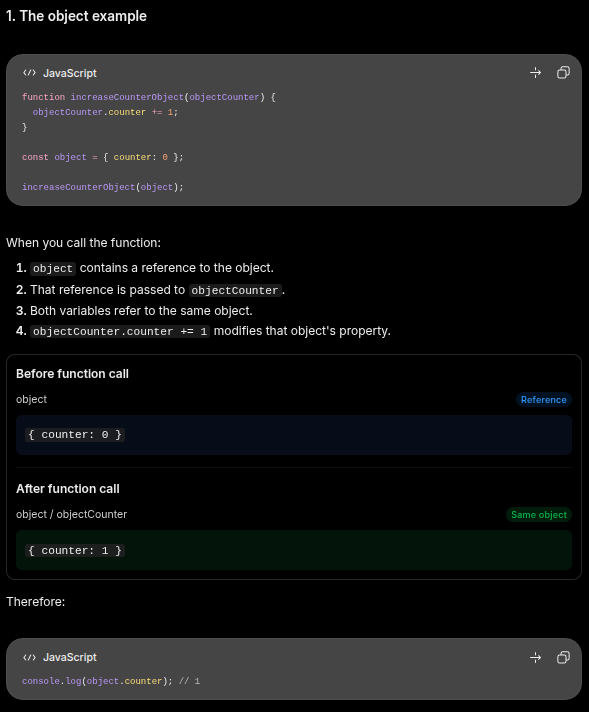
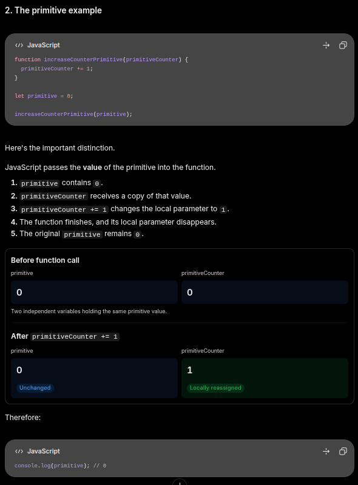

# Objects

## Modifying objects

```JavaScript
let user = {}

user.name = "Harvy";
user.age = 31;
user["likes birds"] = true;
```

- `delete user.age` this will remove the `age` property from the `user` object.
- For multiword property names, use qoutations: `"likes birds": true`.
  - when we want to access that property, we need to use a square bracket instead of the dot notation

  ```JavaScript
  //this will result in syntax error
  user.likes birds = true;

  //use bracket notation
  console.log(user["likes birds"] ) // true
  ```

## Computed Property

Lets say we have an object and we want to let the user to define the key and its pair value. We can do this by using the computed property.

In simpler terms:

> Instead of manually writing a property name, you let JavaScript calculate or retrieve the property name for you.

It uses square brackets [] inside an object literal.

1. What problem does it solve?
   Normally, when creating an object, you write property names directly:

   ```JavaScript
   let fruit = "apple";

   let bag = {
     fruit: 5
   };
   ```

   The resulting object is:

   ```JavaScript
   {
     fruit: 5
   }
   ```

   But what if you want the property name to come from a variable?
   You might try:

   ```JavaScript
   let fruit = "apple";

   let bag = {
     fruit: 5
   };
   ```

   That doesn't work because JavaScript interprets `fruit` as the literal property name "fruit".
   Computed property names solve this:

   ```JavaScript
   let fruit = "apple";

   let bag = {
     [fruit]: 5
   };

   //result

   {
     apple: 5
   }
   ```

   **One important distinction:**
   | Syntax | Meaning |
   |---|---|
   | fruit: 5 | Literal property name "fruit" |
   | [fruit]: 5 | Property name comes from the value of fruit |
   | ["apple"]: 5 | Property name is "apple" |

   _Use case 1_: Dynamic object properties
   Imagine building a shopping cart.

   ```JavaScript
   function addToBag(bag, fruit, quantity) {
     bag[fruit] = quantity;
   }

   let bag = {};

   addToBag(bag, "apple", 5);
   addToBag(bag, "banana", 3);

   console.log(bag);
   ```

   Result:

   ```JavaScript
   {
     apple: 5,
     banana: 3
   }
   ```

   Without dynamic property names, you'd have to manually create each property.

   Notice that bag[fruit] uses the same concept, but with bracket notation for accessing or assigning properties after the object has been created.

   _Use case 2_: Form data
   Imagine a form with multiple fields:

   ```JavaScript
   let fieldName = "email";
   let fieldValue = "user@example.com";

   let formData = {
     [fieldName]: fieldValue
   };

   console.log(formData);
   ```

   Result:

   ```JavaScript
   {
     email: "user@example.com"
   }
   ```

   You can reuse the same logic for username, password, address, and other fields.

## Property existence test, “[in]” operator

A notable feature of objects in JavaScript, compared to many other languages, is that it’s possible to access any property. There will be no error if the property doesn’t exist!

Reading a non-existing property just returns undefined. So we can easily test whether the property exists

There’s also a special operator "in" for that.

The syntax is:

```JavaScript
"key" in object
```

For instance:

```JavaScript
let user = { name: "John", age: 30 };

alert( "age" in user ); // true, user.age exists
alert( "blabla" in user ); // false, user.blabla doesn't exist
```

Please note that on the left side of in there must be a property name. That’s usually a quoted string.

## [The "for..in" loop]

## [Ordered like an object]

Are objects ordered? In other words, if we loop over an object, do we get all properties in the same order they were added? Can we rely on this?

The short answer is: “ordered in a special fashion”: integer properties are sorted, others appear in creation order. The details follow.
As an example, let’s consider an object with the phone codes:

```JavaScript
let codes = {
  "49": "Germany",
  "41": "Switzerland",
  "44": "Great Britain",
  // ..,
  "1": "USA"
};

for (let code in codes) {
  alert(code); // 1, 41, 44, 49
}
```

## [MDN Object]

### Constructors

So we already know what an object is. We can create one by simply declaring it. Like the example below.

```JavaScript
const person = {
  name: "Harvy",
  introduceSelf: function(){
    console.log(`Hi! My name is ${this.name}`)
  },
}
```

This is fine if we are creating only one to two objects. But lets say we want to create an object with the `name` key having a different person's name. Imagine having to create 1,000 objects for 1000 people. One thing we can do is create a function that returns takes the `name` of the person and returns the object.

```JavaScript
function createPerson(name){
  const obj = {};
  obj.name = name;
  obj.introduceSelf = function(){
    console.log(`Hi! My name is ${this.name}.`)
  }

  return obj;
}
```

Now we can create different objects for different persons.

> **Note**: You are probably wondering what `this` is. The `this` keyword typically refers to the current object the code is being executed in. In the context of an object method, `this` refers to the object that the method was called on.  
> So in essence, we are telling the JavaScript engine to get the `name` key property from `this` object.
>
> ### Understanding `this`
>
> The `this` keyword refers to the object determined by how a function is called.
> In the context of an object method, `this` typically refers to the object that the method was called on.
> For example:
>
> ```js
> const person = {
>   name: "Alex",
>
>   introduceSelf() {
>     console.log(`Hi! My name is ${this.name}`);
>   },
> };
>
> person.introduceSelf();
> ```
>
> When `person.introduceSelf()` executes:
>
> 1.  JavaScript sees that the method is called through `person`.
> 2.  `this` refers to `person`.
> 3.  `this.name` accesses the `name` property of `person`.
> 4.  The result is `"Alex"`.
>
> **Mental model:** Think of `this` as a reference to the object associated with the current method call.
> **Important:** `this` is not determined by where a function is written. Its value depends on how the function is invoked. Arrow functions have different `this` behavior because they inherit `this` from their surrounding scope.

```JavaScript
const luci = createPerson("Harvy");

console.log(luci.name) // "Harvy"
console.log(luci.introduceSelf()) // Hi! My name is Harvy.

const gary = createPerson("Gary")

console.log(gary.name) // "Gary"
console.log(gary.introduceSelf()) // Hi! My name is Gary.
```

This works fine but everytime we call the function `createPerson()`, the process of creating an object, assigning values and returning it always repeats. A better way is to use a **_constructor_**. A constructor is just like a function called using the `new` keyword.

When you call a constructor, it will:

- create a new object
- bind this to the new object, so you can refer to this in your constructor code
- run the code in the constructor
- return the new object.

Constructors, by convention, start with a capital letter and are named for the type of object they create. So we could rewrite our example like this:

```JavaScript
function Person(name) {
  this.name = name;
  this.introduceSelf = function () {
    console.log(`Hi! I'm ${this.name}.`);
  };
}
```

To call Person() as a constructor, we use `new` keyword:

```JavaScript
const luci = new Person("Harvy");
luci.introduceSelf();
// "Hi! I'm Harvy."
```

## Class(WIP)

But here come another problem. Lets say we want to add the `age` key to it. We can add the `age` key property to the object itself but having to retype it to every object is workload heavy.

```JavaScript
luci.age = 31;
gary.age = 29;
```

## Object vs Primitive

Consider this code below. What do you think would be the value. The answer is below

```JavaScript
function increaseCounterObject(objectCounter) {
  objectCounter.counter += 1;
}

function increaseCounterPrimitive(primitiveCounter) {
  primitiveCounter += 1;
}

const object = { counter: 0 };
let primitive = 0;

increaseCounterObject(object);
increaseCounterPrimitive(primitive);

```

### The object



### The primitive



### Reference

[1]: (https://javascript.info/object)
[in]: (https://javascript.info/object#property-existence-test-in-operator)
[The "for..in" loop]: (https://javascript.info/object#forin)
[Ordered like an object]: (https://javascript.info/object#ordered-like-an-object)
[MDN Object]: (https://developer.mozilla.org/en-US/docs/Learn_web_development/Core/Scripting/Object_basics)
